<p align="center">
  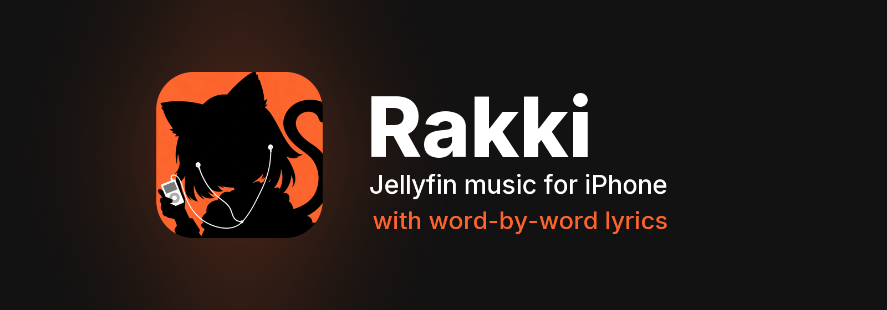
</p>

<p align="center">
  <a href="https://github.com/LuckiRakki/rakki/releases/tag/ios-latest"></a>
  
  
  
  <a href="LICENSE"></a>
</p>

<p align="center">
  <a href="https://github.com/LuckiRakki/rakki/actions/workflows/check.yml"></a>
  <a href="https://github.com/LuckiRakki/rakki/actions/workflows/update.yml"></a>
</p>

<p align="center">
  <b><a href="#install">Install</a></b> ·
  <b><a href="#features">Features</a></b> ·
  <b><a href="#see-it">Screenshots</a></b> ·
  <b><a href="#lyrics-setup">Lyrics setup</a></b> ·
  <b><a href="#build-it-yourself">Build it yourself</a></b> ·
  <b><a href="docs/CHANGELOG.md">Changelog</a></b>
</p>

---

**AI NOTICE** This project is primarily led by [Claude Code](https://github.com/anthropics/claude-code). I understand the feelings some have toward AI usage so use this statement as an AI disclosure.

**Rakki** is a music app for your own [Jellyfin](https://jellyfin.org) server, made for the
iPhone. It looks and feels like Spotify, does what Finamp and Feishin do, and has word-by-word
karaoke lyrics at its heart that glow, lift and pop as they're sung, in the style of
[Spicy Lyrics](https://github.com/Spikerko/spicy-lyrics) (an unofficial port; see Thanks).

It's built with React Native and Expo, plays through its own gapless audio engine written in
Swift, and updates itself over the air. Building and running it needs no Mac and no paid
Apple account.

## See it

<p align="center">
  
  &nbsp;
  
  &nbsp;
  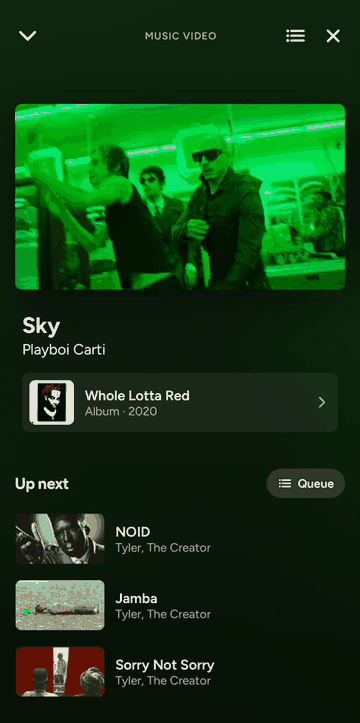
</p>

<table>
  <tr>
    <td align="center">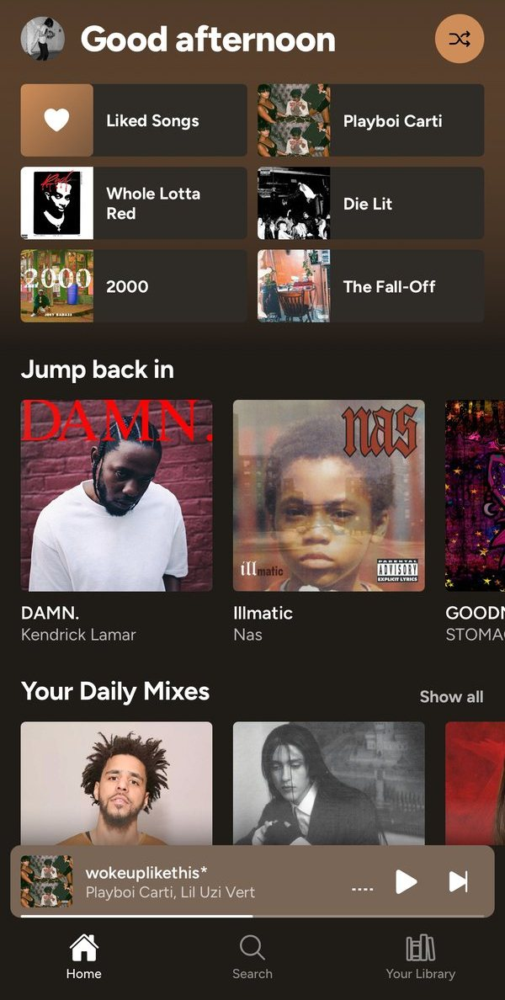<br><sub>Home</sub></td>
    <td align="center"><br><sub>Now playing</sub></td>
    <td align="center"><br><sub>Spicy lyrics</sub></td>
    <td align="center">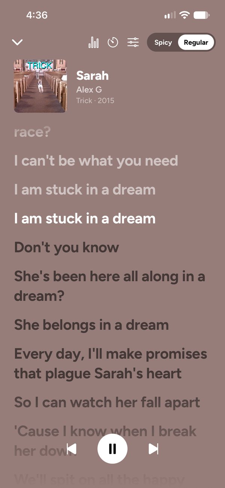<br><sub>Regular lyrics</sub></td>
  </tr>
  <tr>
    <td align="center">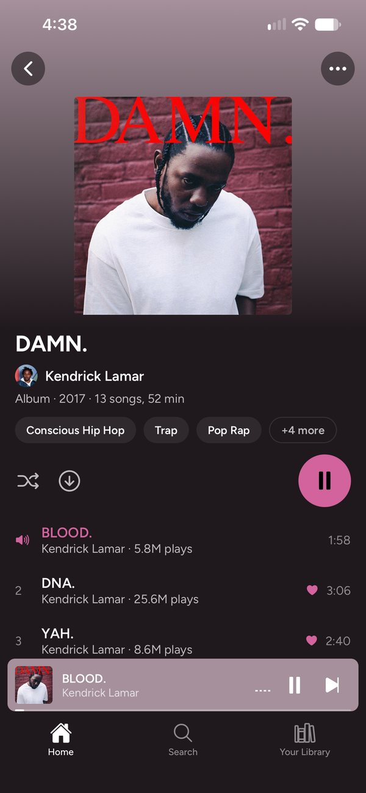<br><sub>Album</sub></td>
    <td align="center">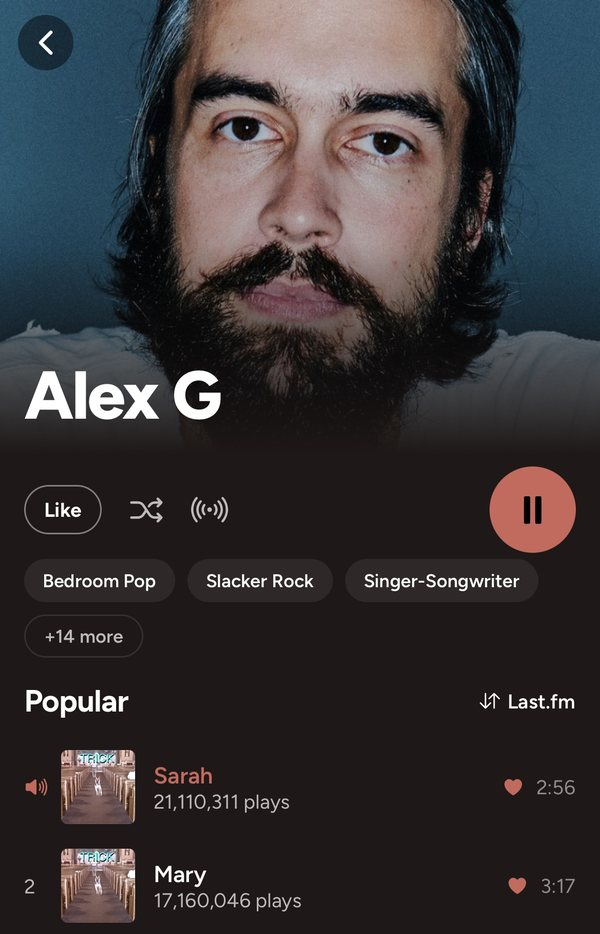<br><sub>Artist</sub></td>
    <td align="center">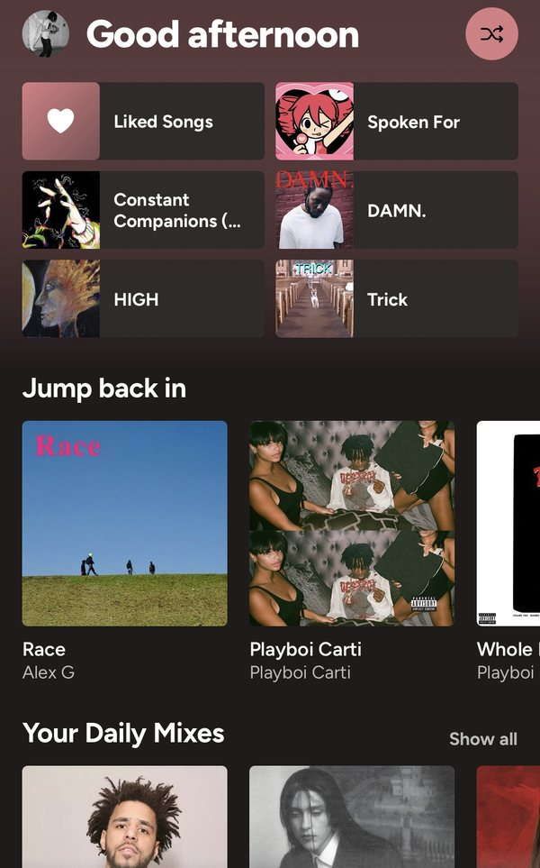<br><sub>Home with Daily Mixes</sub></td>
    <td align="center">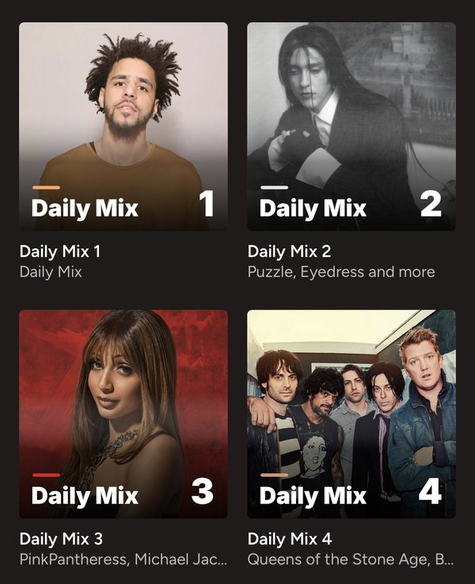<br><sub>Daily Mixes</sub></td>
  </tr>
  <tr>
    <td align="center">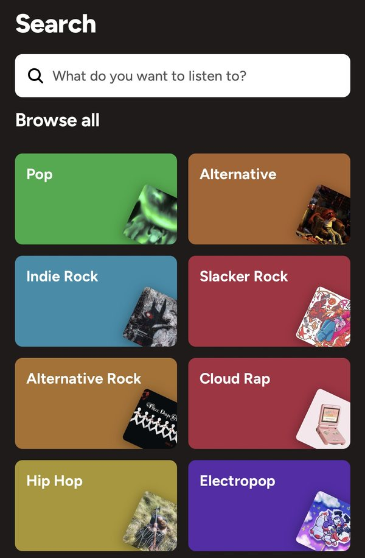<br><sub>Search</sub></td>
    <td align="center">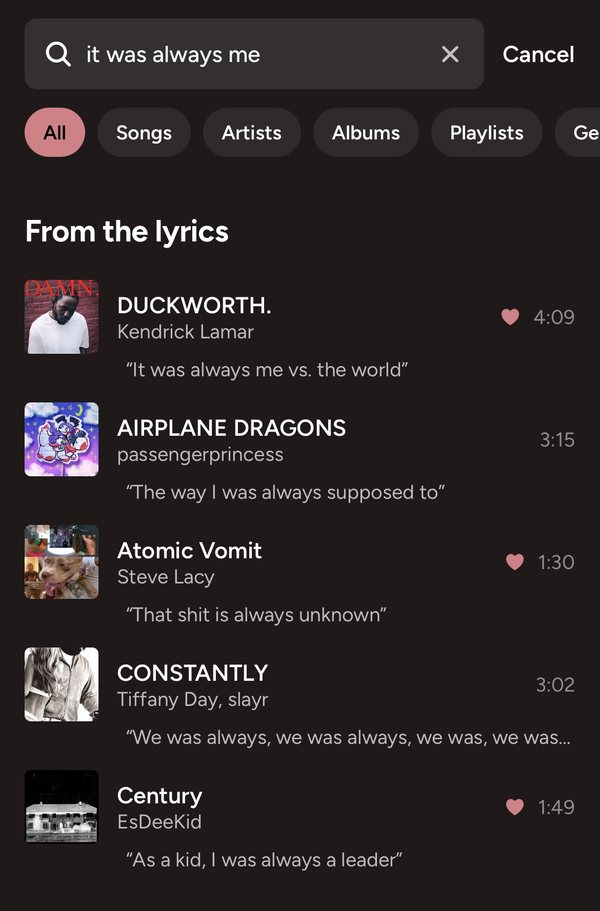<br><sub>Search by lyrics</sub></td>
    <td align="center">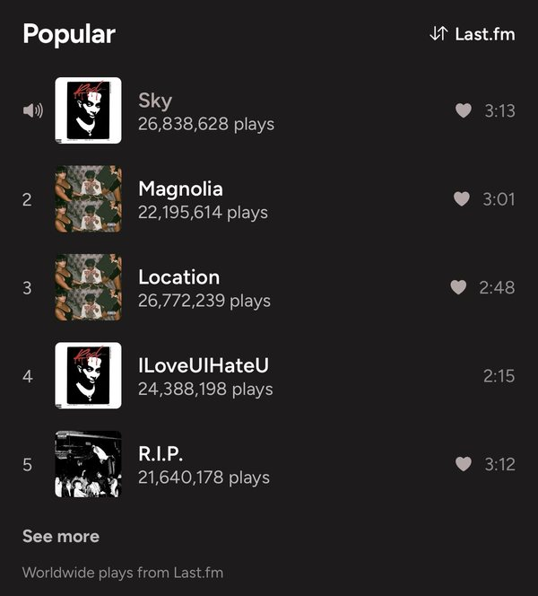<br><sub>Popular (Last.fm plays)</sub></td>
    <td align="center">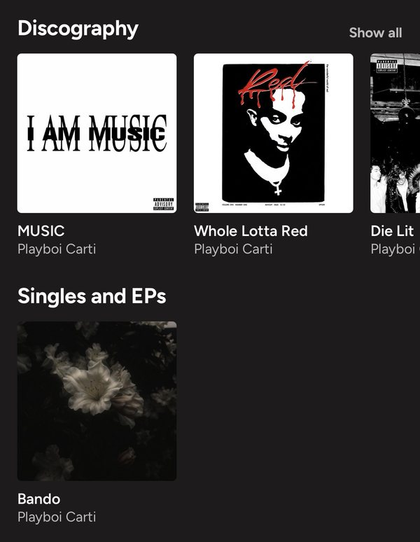<br><sub>Discography, singles and EPs</sub></td>
  </tr>
  <tr>
    <td align="center">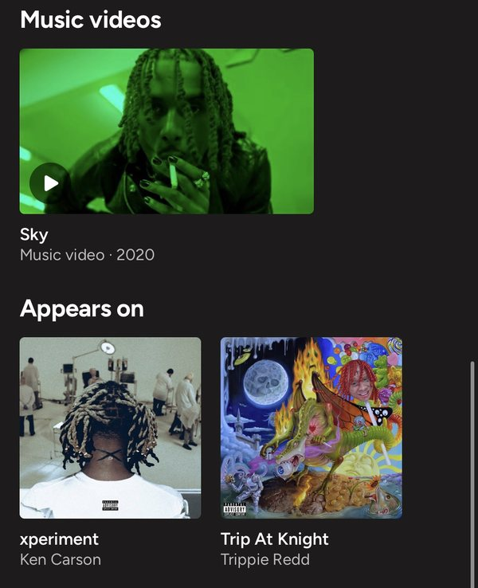<br><sub>Music videos, Appears on</sub></td>
    <td align="center">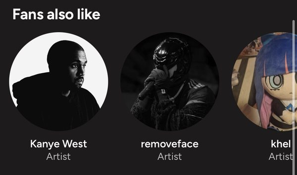<br><sub>Fans also like</sub></td>
    <td align="center">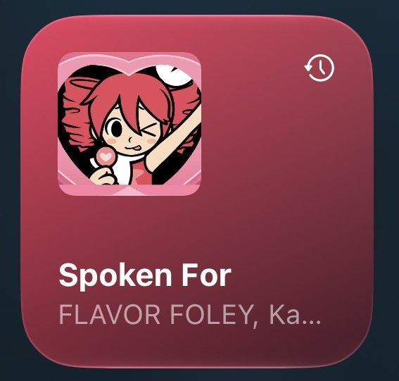<br><sub>Now Playing widget</sub></td>
    <td align="center">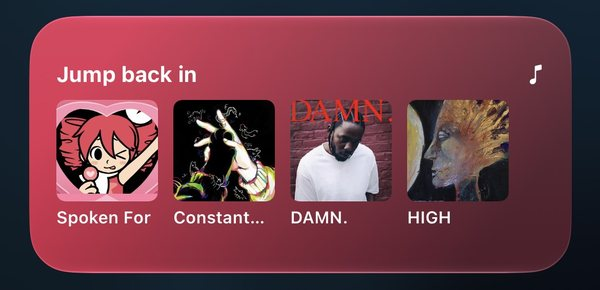<br><sub>Jump Back In widget</sub></td>
  </tr>
  <tr>
    <td align="center">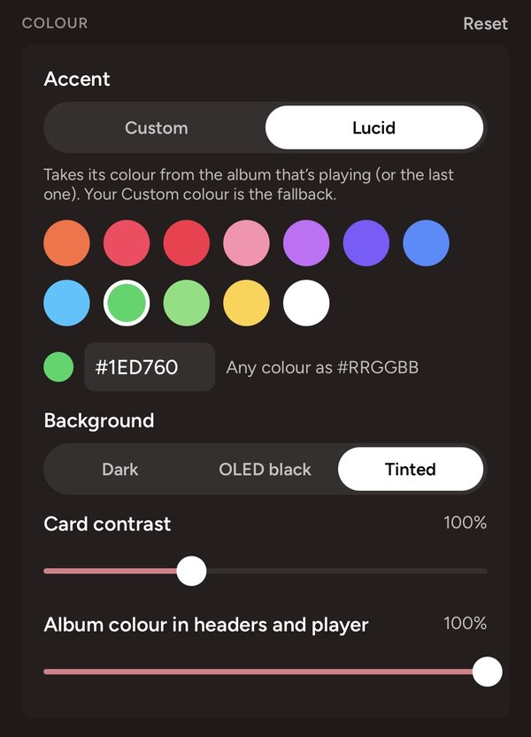<br><sub>Colour (Lucid or your own)</sub></td>
    <td align="center">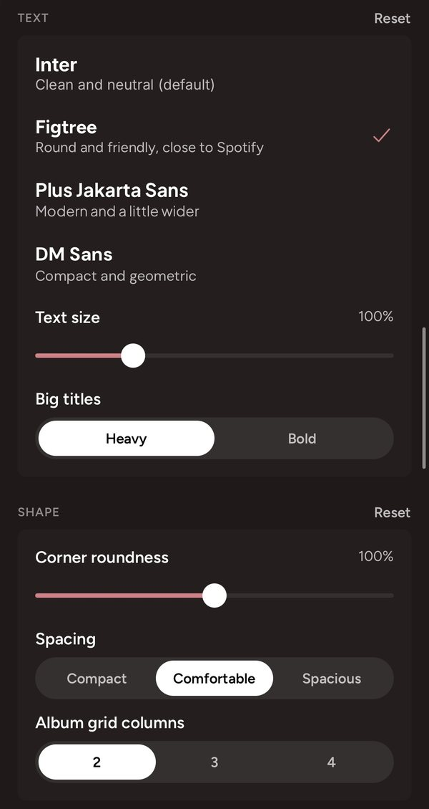<br><sub>Fonts and shape</sub></td>
    <td align="center">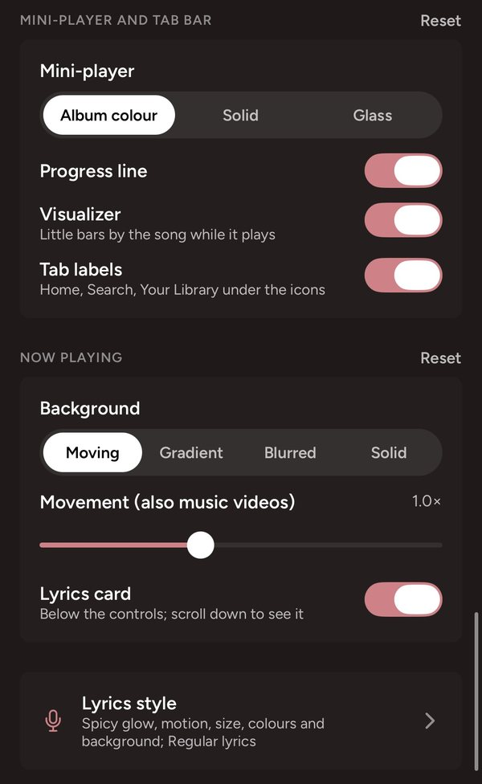<br><sub>Mini-player and Now Playing</sub></td>
    <td align="center">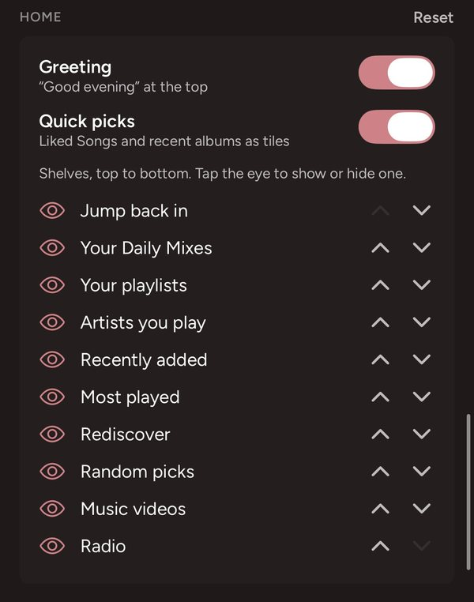<br><sub>Customize Home</sub></td>
  </tr>
  <tr>
    <td align="center">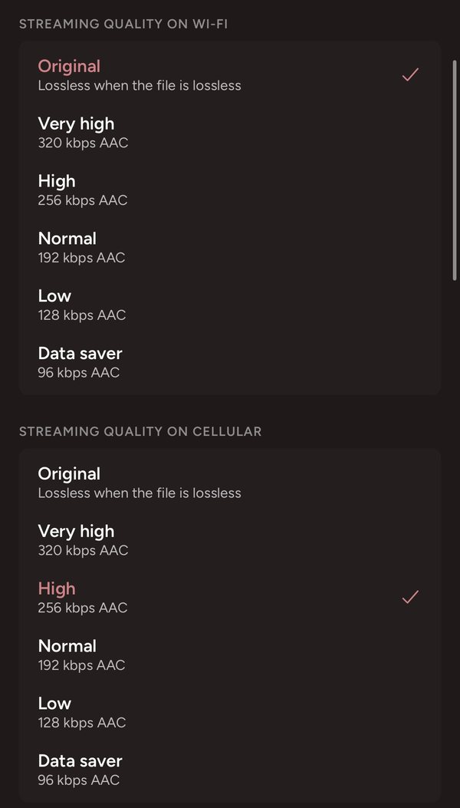<br><sub>Streaming quality</sub></td>
    <td align="center">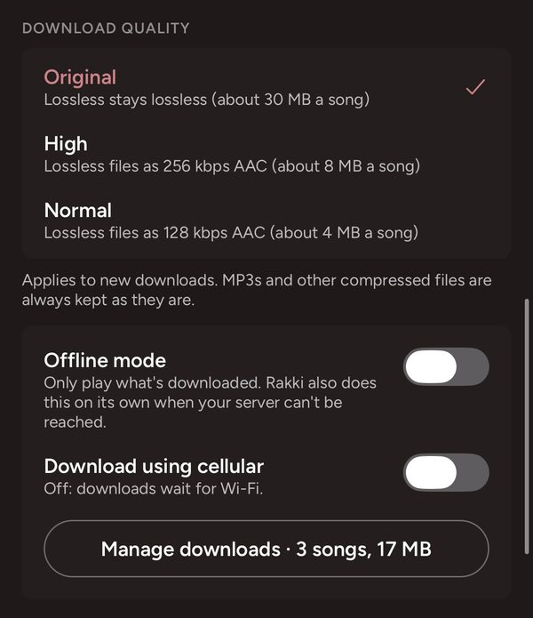<br><sub>Downloads and offline</sub></td>
    <td align="center">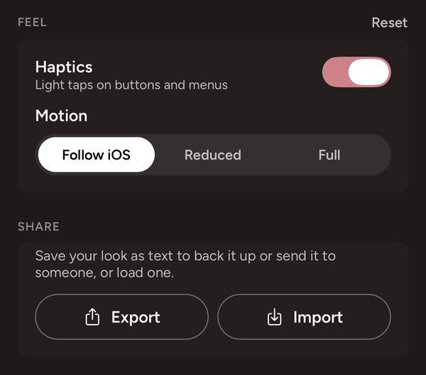<br><sub>Haptics, motion, share your look</sub></td>
    <td></td>
  </tr>
</table>

## Features

### Lyrics, two ways
- **Spicy mode** (the default): an unofficial port of Spicy Lyrics' look and motion, drawn on a
  GPU canvas. Every word has its own springs for size, lift and glow; long notes are spelled
  out letter by letter; duets sit left and right; background vocals, instrumental dots, and
  depth blur on the lines around the one being sung. Tap a line to jump to it.
- **Regular mode**: clean line-by-line lyrics on the album's colour, for when you just want to
  read along. One tap switches between the two.
- A **lyrics card** under the player controls (scroll down), and full-screen lyrics that close
  with a swipe down.
- **Search by lyrics**: type a line you remember and Search finds the song ("From the lyrics").
- Japanese, Chinese, Korean and other scripts fall back to iOS's own fonts.
- A lyrics style editor (size, font, colour, motion, backdrop) with a live preview.
- How to get word-by-word lyrics for your songs: [Lyrics setup](#lyrics-setup).

### Player
- Its own **gapless** engine (an AVQueuePlayer that always has the next song ready), with the
  lock screen, Control Center, AirPlay and headphone controls.
- A queue with drag to reorder, Next in queue, shuffle (a toggle that stays on for new queues)
  and repeat, restored on launch.
- A **smart queue** for autoplay and song/artist radio: songs like the ones playing, from what
  Last.fm listeners play alongside them, the artists they like next, your own likes and most
  played, and Jellyfin's instant mix, mixing songs you know with new ones. The first song
  starts at once; the rest fills in behind it within seconds.
- **Music videos** from your Jellyfin library, matched to your songs and played in the app,
  in the player or full screen (picture in picture, AirPlay, lock screen controls). While a
  video plays, the music steps aside and picks up where it left off.
- A **visualizer** that follows the actual sound, in the mini-player and the lyrics screen.
- A sleep timer, volume normalization and song credits.

### Your library
- **Home** with quick picks, Jump back in, Your Daily Mixes, Recently added, Most played,
  Rediscover and more (reorder or hide any of them). **Search** that forgives typos, with
  Browse all by genre. A **Library** with Playlists, Mixes, Albums, Songs, Artists, Genres,
  Radio, Videos and Downloads (hold a tab to reorder them).
- **Daily Mixes**: six fresh 100-song mixes every night, each led by a different artist you
  play and kept to one kind of music, mixing popular songs, ones you play a lot and ones that
  are new to you (no more than 3 from one album, and songs you keep skipping left out). Each
  gets a cover with its artist's photo. Made on your server by the Rakki plugin.
- **Artist pages** like Spotify's: Popular (worldwide plays from Last.fm, or your own),
  Discography with Singles and EPs, Music videos, Appears on, and Fans also like.
- Album, playlist and genre pages (with find, sort and the total length), a Spotify-style
  **Add to playlist** that shows where a song already is, and playlist editing. A heart on
  every song that's liked or in one of your playlists.

### Widgets
- **Now Playing** (small, medium and Lock Screen): the song and its cover; tap to open the
  player.
- **Jump Back In** (medium and large): what you played last, one tap away.

### Offline and data
- Download albums, playlists and Liked Songs, with their lyrics and covers. They're real
  files you can see in the Files app.
- **Streaming quality** set separately for Wi-Fi and cellular (Original lossless down to a
  96 kbps data saver), and **download quality** (keep lossless, or save space as AAC).
- Offline mode plays what's on the phone, and plays made offline still count once you're back.

### Radio
- Any internet radio by its address, plus **SUB/WAVE** stations built in: what's on air, the
  show and DJ, song requests, recently played, and lyrics that follow the live stream.
- A proper live lock screen: LIVE, stop, no skipping.

### Make it yours
- An accent colour of your choice, or **Lucid**: the colour of the album that's playing. Dark,
  OLED black or tinted backgrounds, and how much of the album colour the headers and player
  take.
- Four fonts, text size, big titles, roundness, spacing and grid columns; the mini-player as
  album colour, solid or glass; a moving, gradient, blurred or solid Now Playing background.
- Haptics and motion (follow iOS, reduced or full). **Export** your look as text to back it up
  or share it, and **import** someone else's.
- Three app icons, and multiple Jellyfin accounts.

<p align="center">
  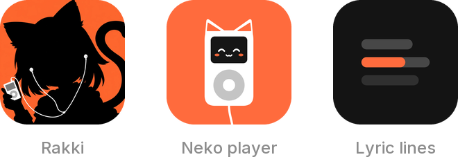
</p>

### CarPlay: in the works
CarPlay isn't here yet, and it isn't for lack of trying. Apple only lets an app show up in
CarPlay with a special **CarPlay audio entitlement**, which it grants to paid developer accounts
($99 a year) on request. Rakki is installed with a free Apple ID through SideStore, and apps
signed that way can't carry the entitlement, so iOS would never show Rakki in the car. The
player is already built so CarPlay can sit on top of it (it's the same engine as the lock
screen); it arrives with a native build once there's a paid account behind it.

## Install

Rakki is sideloaded with **[SideStore](https://sidestore.io)** and a free Apple ID.

1. Set up SideStore on your iPhone (its site walks you through it).
2. On the iPhone, download **[Rakki.ipa](https://github.com/LuckiRakki/rakki/releases/download/ios-latest/Rakki.ipa)**
   from the [latest release](https://github.com/LuckiRakki/rakki/releases/tag/ios-latest).
3. In SideStore, go to **My Apps → +** and pick the file.
4. Open Rakki and enter your Jellyfin server's address (`http://` works too), then sign in with
   your password or Quick Connect.

**Updates arrive on their own.** New versions are published over the air and download the
next time you open Rakki (or right away from **Settings → About → Check for updates**). You
only need a new `.ipa` when the native side changes; the changelog says when.

**For word-by-word lyrics, Daily Mixes and the rest**, the server needs the Rakki plugin for
Jellyfin ([server/](server/README.md)). Without it, Rakki uses Jellyfin's own lyrics (LRC or
plain text).

## Lyrics setup

Rakki shows the best lyrics it can find for a song, in this order:

1. **Word-by-word lyrics from the Rakki plugin**, which has two sources: a `.ttml` file next to
   the song (local), and the Spicy Lyrics API (online). By default a local file wins; the
   plugin's "Prefer the API" setting flips that.
2. **Jellyfin's own lyrics**: `.lrc` files next to the song, lyrics embedded in the file, or
   what a lyrics plugin such as LrcLib fetched. These scroll line by line.

Both word-by-word sources need the **Rakki plugin** on your server ([server/](server/README.md)):
copy it into Jellyfin's plugins folder and restart Jellyfin. Its settings are in
**Dashboard → Plugins → Rakki**.

### Local `.ttml` files

A `.ttml` file is Apple Music's word-timed lyrics format. Put one next to the song with the
**same file name**:

```
Music/Alex G/Trick/04 - Sarah.flac
Music/Alex G/Trick/04 - Sarah.ttml
```

That's all: no IDs and nothing online. Rakki picks it up the next time the song plays. To get
`.ttml` files without hunting for them, turn on **Lyrics: nightly TTML scraper** in the
plugin's settings: every night at 3 AM it looks up songs that have none (through the public
LyricsPlus service) and writes the file next to the song. If a file's timing is a little early
or late, fix it with the timer button on the lyrics screen and tap **Save to server**: the
plugin moves every line and word in the file (keeping the original as `.orig`), so every app
gets the fix.

### The Spicy Lyrics API (online)

[Spicy Lyrics](https://github.com/Spikerko/spicy-lyrics) has word-by-word lyrics for a huge number of songs,
looked up by **Spotify track ID**. The plugin does the looking up and Rakki shows the result,
with the provider and the people who synced it credited under the lyrics, as the API's terms
require.

1. **Get a key.** Each server needs its own Spicy Lyrics key (the terms don't allow sharing
   one, so Rakki can't ship with one). Rakki has applied for a Spicy Lyrics *app template*:
   once it's approved, getting your key is one click from the plugin's settings page. Until
   then, create an application at
   [developers.spicylyrics.org](https://developers.spicylyrics.org) and copy its **secret key**
   (`sl_sk_...`).
2. **Paste it** in Dashboard → Plugins → Rakki → **Lyrics: Spicy Lyrics API**, tick **Enable**
   and save. It stays on your server; the app never sees it.
3. **Give your songs a way to Spotify.** The plugin finds a song's Spotify ID without any
   Spotify account: it reads the Spotify link that **MusicBrainz** keeps for the recording. So
   tag your files with MusicBrainz IDs ([MusicBrainz Picard](https://picard.musicbrainz.org)
   does this), or set a **Spotify** ID on a song by hand (Jellyfin → the song → Edit metadata
   → External IDs) when MusicBrainz has no link.

Lyrics from the API are fetched the first time a song plays, kept on the server for speed,
refreshed every night at 4 AM before they're 30 days old, and deleted if they can't be
refreshed in time (the API's terms). They're never stored on the phone, so downloaded songs
show their local or Jellyfin lyrics offline.

## How it works

**The server does the heavy lifting.** The Rakki plugin runs these every night (Dashboard →
Scheduled Tasks, where you can move or run them):

| When | Task |
|---|---|
| 12 AM | Rakki Daily Mixes: builds the day's six mixes and their covers |
| 3 AM | TTML scraper: `.ttml` files for songs that have none (if turned on) |
| 4 AM | Spicy Lyrics API refresh: keeps cached lyrics inside the 30-day limit |
| 5 AM | Lyrics search index: reads every song's lyrics so Search can find words |

It also notes skips (songs stopped before halfway, from any app) for Daily Mixes, keeps
Last.fm answers for 30 days, and shares your Last.fm key with the app so it's entered once.

**The phone keeps what it can, so it stays fast and light on data:**

- **Covers and pictures** are cached on the phone after the first look.
- **Search** runs on the phone: a name index of your whole library is downloaded once, then
  topped up every few hours with only what changed (rebuilt weekly).
- **Playlists**: which songs each playlist has is kept on the phone, so Add to playlist shows
  its ticks at once; one cheap check finds what changed on the server (from any app).
- **Last.fm** answers (popular songs, similar artists) are kept for a week.
- **Your queue** and position come back after the app closes.
- **Offline listens** are kept and sent when the server is back, so play counts catch up.
- In the background Rakki lets go of its heavy parts (pictures, blur, the lyrics canvas) to
  save memory and battery, and puts them back when you return.

**Updates** arrive over the air (EAS Update): new versions download the next time Rakki opens.
A new `.ipa` is only needed when the native side changes.

**Performance log** (Settings): an opt-in log of what the app does to the phone (CPU, memory,
heat, battery, data, crashes), uploaded to your Jellyfin server and readable on the plugin's
settings page, to look into app performance on device hardware.

## Your Tags Matter

Rakki is **metadata driven**: it reads what's in your music files' tags (through Jellyfin), so
it works best with a clean library. In particular:

- **Artists separated properly.** Each artist in its own artist tag (or split with `;`), not
  `Artist A, Artist B` in one field, and the same spelling everywhere. Artist pages, the smart
  queue and Daily Mixes all go by artist, and a joined or misspelled name becomes a separate
  artist.
- **Album artist on every song**, so albums stay together and land under the right artist.
- **Genre tags.** Daily Mixes group your music by genre (Jellyfin's genres plus Last.fm's
  tags), so missing or odd genres make looser mixes.
- **MusicBrainz or Spotify IDs** for word-by-word lyrics from the Spicy Lyrics API: it looks
  songs up by Spotify ID, which the Rakki plugin finds through the song's MusicBrainz
  recording (tag with MusicBrainz Picard, or set a `Spotify` provider ID on the song).
  `.ttml` lyric files next to your songs work without any IDs.
- **Artist pictures** (Jellyfin fetches them): artist pages and Daily Mix covers use them.

## Build it yourself

Everything runs on Windows, macOS or Linux; iOS builds happen on GitHub's Macs.

```bash
npm install
npm run web:setup              # once: the canvas library for Spicy lyrics in the browser
npm run web                    # the web preview (most screens)
npm run phone -- --dev-client  # dev server on this PC's Tailscale address, for Rakki Dev
npm run typecheck
npm run lint
```

| Workflow | When | What it does |
|---|---|---|
| [`check.yml`](.github/workflows/check.yml) | every push | typecheck and lint |
| [`update.yml`](.github/workflows/update.yml) | every push to `main` | publishes an over-the-air update (EAS Update) |
| [`ios.yml`](.github/workflows/ios.yml) | by hand | builds an unsigned `.ipa`: `release` (published as `ios-latest`), `dev` (Rakki Dev, which loads code from your PC) or `check` (build only) |

The plan, architecture and decisions are in **[docs/FRAMEWORK.md](docs/FRAMEWORK.md)**; what
changed in each version is in **[docs/CHANGELOG.md](docs/CHANGELOG.md)**.

```
src/app/               screens (Expo Router)
src/player/            queue, playback reporting, sleep timer, offline listens
src/spicy/             the Spicy Lyrics renderer (Skia)
src/lyrics/            lyrics loading and Regular mode
src/radio/             internet radio and SUB/WAVE
src/widgets/           Home Screen and Lock Screen widgets
modules/rakki-audio/   the native audio engine (Swift)
```

## What's next

- **CarPlay**, once there's a paid developer account (see [CarPlay](#carplay-in-the-works)).
- **A Jellyfin music suite:** the tools that keep a library's tags clean enough for Rakki
  (a review queue for new music, a Spotify playlist monitor, downloader tagging) together
  with a step-by-step guide to setting up Rakki and its server side.

## Thanks

Rakki stands on other people's work: [Spicy Lyrics](https://github.com/Spikerko/spicy-lyrics)
(the look and motion of the lyrics, ported unofficially), [Finamp](https://github.com/jmshrv/finamp) and `just_audio` (how a
gapless iOS player is built), [Feishin](https://github.com/jeffvli/feishin) (the look and the
feature set), [Jellyfin](https://jellyfin.org) and [Expo](https://expo.dev). Details are in
[NOTICE.md](NOTICE.md).

## Licence

[AGPL-3.0](LICENSE). Rakki is an unofficial app: it isn't affiliated with or endorsed by
Jellyfin, Spotify or Spicy Lyrics.
